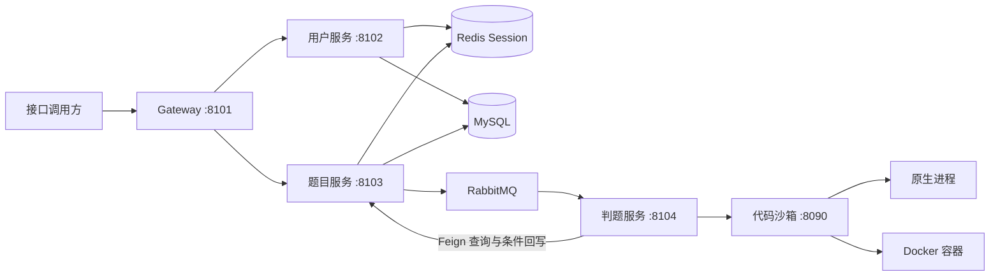

# 在线编程评测平台

基于 Spring Cloud、RabbitMQ 和 Docker 的在线编程评测后端，提供用户管理、题目维护、代码提交、隔离执行与异步评测，形成从题目发布到结果查询的完整流程。

以微服务版本为主要运行方式，同时保留单体后端和独立代码沙箱。当前交付聚焦后端，通过 Knife4j 接口文档即可运行和体验，工程目录及服务标识保留为 `yjoj`。

## 目录

- [功能与特性](#功能与特性)
- [系统架构](#系统架构)
- [技术栈](#技术栈)
- [工程结构](#工程结构)
- [快速启动](#快速启动)
- [配置说明](#配置说明)
- [接口使用示例](#接口使用示例)
- [单体运行](#单体运行)
- [验证情况与已知限制](#验证情况与已知限制)

## 功能与特性

业务划分为三个模块：

|模块|主要功能|
|---|---|
|用户模块|注册、登录、注销、个人资料、公开用户查询、管理员管理；角色变更和删除用户后撤销已索引会话|
|题目模块|登录用户创建题目，创建者或管理员维护；公开题目查询隐藏答案和用例；提交记录查询及源码权限控制|
|判题模块|异步任务执行、条件抢占、答案比较、资源判断、结果回写、通过数统计、重复消息和旧轮次保护|

核心技术实现：

- **独立代码沙箱**：保留 Java 原生进程与 Docker 两种执行方式，通过配置切换；支持鉴权、超时控制及临时目录和容器清理。
- **异步评测与有限重试**：RabbitMQ 分发任务，手动 ACK；临时系统故障按 5/30/120 秒延迟重试，耗尽后保存最终失败并发送通知。
- **状态与轮次校验**：数据库条件更新约束抢占和回写，阻止旧轮次覆盖新结果，重复完成不重复累计通过数。
- **流量保护**：Gateway 对指定接口限流，返回统一 429/503；Sentinel 对沙箱调用熔断，用户代码错误不计入系统故障。
- **共享登录态**：Redis Session 支持跨业务服务识别用户；权限注解、所有者检查和 VO 转换共同控制访问范围。

当前支持 Java，输入通过 `Main.main(String[] args)` 传入。尚未实现标准输入、多语言、比赛和排行榜。

## 系统架构



一次代码提交的处理过程：

1. 题目服务校验用户、题目、语言和代码，事务内保存 `WAITING` 提交并增加提交数。
2. 事务提交后发布提交 ID 和执行轮次，等待发布确认后返回提交 ID。
3. 判题服务消费消息，通过题目服务条件抢占为 `RUNNING`，获取题目用例和资源限制。
4. 独立沙箱编译代码、逐用例执行，返回输出、错误、耗时和内存数据。
5. 判题策略比较答案与资源，题目服务条件保存结果；Accepted 时在同一事务增加通过数。
6. 消费者确认消息，客户端通过提交 ID 轮询结果。临时故障进入有限延迟重试流程。

源码入口：[题目接口](./yjoj-backend-microservice/yjoj-backend-question-service/src/main/java/com/luoyujia/yjoj/question/controller/QuestionController.java) · [提交业务](./yjoj-backend-microservice/yjoj-backend-question-service/src/main/java/com/luoyujia/yjoj/question/service/impl/QuestionSubmitServiceImpl.java) · [判题编排](./yjoj-backend-microservice/yjoj-backend-judge-service/src/main/java/com/luoyujia/yjoj/judge/judge/JudgeServiceImpl.java) · [消息消费](./yjoj-backend-microservice/yjoj-backend-judge-service/src/main/java/com/luoyujia/yjoj/judge/rabbitmq/MyMessageConsumer.java) · [沙箱模板](./yjoj-code-sandbox/src/main/java/com/luoyujia/yjoj/sandbox/JavaCodeSandboxTemplate.java)。

## 技术栈

|分类|技术与版本|
|---|---|
|语言与框架|Java 8；Spring Boot：微服务 2.6.13、单体 2.7.2、沙箱 2.7.14|
|微服务|Spring Cloud 2021.0.5、Alibaba 2021.0.5.0、Gateway、OpenFeign；Gateway 的 Cloud 为 2021.0.8|
|数据存储|MySQL 8、MyBatis-Plus 3.5.2|
|会话与消息|Redis 6、Spring Session、RabbitMQ 3.12.6|
|注册发现与保护|Nacos 2.2.0、Sentinel 1.8.6|
|接口文档|Springfox、Knife4j：微服务 4.3.0、单体 3.0.3|
|代码执行|ProcessBuilder、docker-java 3.3.0、Docker Java 8 运行镜像|
|构建与环境|Maven Wrapper、Docker Compose|

各工程 POM 为应用依赖的版本依据。单体和微服务 Wrapper 使用 Maven 3.9.11，沙箱根 Wrapper 使用 3.8.7。

## 工程结构

```text
.
├─ README.md
├─ compose.yaml                         本地中间件编排
├─ yjoj-backend/                        单体后端
│  ├─ src/
│  └─ sql/create_table.sql              根 Compose 初始化入口
├─ yjoj-code-sandbox/                   独立代码沙箱
│  └─ src/main/java/com/luoyujia/yjoj/sandbox/
│     ├─ controller/                   HTTP 入口、鉴权和实现选择
│     ├─ JavaCodeSandboxTemplate.java   保存、编译、执行、汇总和清理
│     ├─ JavaNativeCodeSandbox.java     原生进程实现
│     └─ JavaDockerCodeSandbox.java     Docker 实现
└─ yjoj-backend-microservice/
   ├─ pom.xml                          微服务聚合构建
   ├─ yjoj-backend-common/              响应、异常、权限和公共常量
   ├─ yjoj-backend-model/               Entity、DTO、VO 和枚举
   ├─ yjoj-backend-service-client/      Feign 内部调用契约
   ├─ yjoj-backend-gateway/             统一入口、文档聚合和限流
   ├─ yjoj-backend-user-service/        用户业务与共享 Session
   ├─ yjoj-backend-question-service/    题目、提交记录和统计
   ├─ yjoj-backend-judge-service/       评测编排、策略与消息消费
   ├─ mysql-init/                      备用编排初始化 SQL
   └─ sql/migrations/                  已有库增量迁移
```

沙箱独立部署；common、model、service-client 和 gateway 为基础模块。单体与微服务保留各自实现，新增限流、熔断和重试主要在微服务版本中。

## 快速启动

推荐采用 **Docker 运行中间件，IDEA 或本地 Java 进程运行应用** 的方式。

### 1. 准备环境

- JDK 8：确认 `java -version`、`javac -version` 均正确，IDEA 的 SDK、Maven 和运行配置使用同一 JDK。
- Docker Engine / Docker Desktop 与 Compose：Docker Desktop 使用 Linux 容器模式。
- 首次构建需要联网下载 Maven 和依赖，使用工程自带 Wrapper 即可。

Docker 模式仍在宿主机使用 javac 编译，容器负责运行；宿主机需要完整 JDK，编译目标须与容器 Java 8 兼容。

### 2. 启动中间件

在仓库根目录执行：

```bash
docker compose up -d
docker compose ps
docker pull eclipse-temurin:8-jre-alpine
```

|服务|宿主机地址|说明|
|---|---|---|
|MySQL|localhost:3308|数据库 `yjoj`|
|Redis|localhost:6380|应用默认使用 database 1|
|RabbitMQ|localhost:5672|管理页 [localhost:15672](http://localhost:15672/)|
|Nacos|localhost:8848|控制台 [localhost:8848/nacos](http://localhost:8848/nacos/)，客户端还需 9848/9849|

Compose 项目名为 `oj`，只启动中间件。默认端口绑定 127.0.0.1；不要同时启动根 Compose 和备用环境编排。

本地默认 MySQL 为 root/123456、RabbitMQ 为 guest/guest，Redis 无密码，Nacos 关闭鉴权。真实部署需覆盖这些本地示例配置并限制访问。

### 3. 初始化数据库

空数据卷首次启动时，Compose 自动执行 [建表脚本](./yjoj-backend/sql/create_table.sql)，创建 `user`、`question`、`question_submit` 三张表。

如果使用已有数据库且提交表缺少 `judgeAttempt`，先备份，再执行 [增量迁移](./yjoj-backend-microservice/sql/migrations/001_add_judge_attempt.sql)。脚本会检查字段是否存在，不需要重新建表。

数据保存在 Docker 命名卷，重启后保留。修改初始化脚本不会自动升级已有数据库；需要保留数据时不要执行 `docker compose down -v`。

### 4. 构建工程

在微服务根目录和沙箱目录分别构建：

```powershell
# Windows PowerShell，在仓库根目录执行
Push-Location yjoj-backend-microservice
.\mvnw.cmd clean verify
Pop-Location

Push-Location yjoj-code-sandbox
.\mvnw.cmd clean verify
Pop-Location
```

Linux/macOS 在对应目录执行 `sh ./mvnw clean verify`。微服务根 POM 会统一构建七个子模块，无需逐个打包。

### 5. 启动应用

IDEA 加载微服务根 POM 和沙箱 POM，按下表顺序启动，每个应用只运行一个实例：

|顺序|启动类|端口|上下文|
|---|---|---|---|
|1|YjojCodeSandboxApplication|8090|根路径|
|2|YjojBackendUserServiceApplication|8102|/api/user|
|3|YjojBackendQuestionServiceApplication|8103|/api/question|
|4|YjojBackendJudgeServiceApplication|8104|/api/judge|
|5|YjojBackendGatewayApplication|8101|根路径|

也可以在打包后通过 `java -jar` 启动。例如，在仓库根目录执行：

```bash
java -jar yjoj-code-sandbox/target/yjoj-code-sandbox-1.0.0.jar
```

其余应用对应各微服务子工程的 `target/<工程名>-1.0.0.jar`，每个进程使用独立终端。不要与 IDEA 重复启动同一应用。

### 6. 访问接口文档

- 沙箱健康检查：[http://localhost:8090/health](http://localhost:8090/health)，正常返回 `ok`。
- 统一接口文档：**[http://localhost:8101/doc.html](http://localhost:8101/doc.html)**。

选择用户服务或题目服务调试。判题服务主要通过 MQ 工作，无需调用文档中的框架 `/error` 接口。

## 配置说明

### 基础配置

|环境变量|应用|默认值 / 用途|
|---|---|---|
|`MYSQL_HOST`、`MYSQL_PORT`、`MYSQL_DATABASE`|用户、题目|localhost、3308、yjoj|
|`MYSQL_USERNAME`、`MYSQL_PASSWORD`|用户、题目|root、本地示例密码；与 MySQL 一致|
|`REDIS_HOST`、`REDIS_PORT`、`REDIS_DATABASE`、`REDIS_PASSWORD`|用户、题目|localhost、6380、1、空密码|
|`NACOS_SERVER_ADDR`|Gateway、业务服务|localhost:8848|
|`RABBITMQ_HOST`、`RABBITMQ_PORT`|题目、判题|localhost、5672|
|`RABBITMQ_USERNAME`、`RABBITMQ_PASSWORD`|题目、判题|本地默认 guest、guest|
|`CODE_SANDBOX_URL`|判题|http://localhost:8090|
|`CODE_SANDBOX_AUTH_HEADER`、`CODE_SANDBOX_AUTH_SECRET`|判题|默认 auth、change-me；真实环境覆盖|
|`SANDBOX_AUTH_HEADER`、`SANDBOX_AUTH_SECRET`|沙箱|与判题端对应值一致|
|`SANDBOX_TYPE`|沙箱|docker；可选 native|
|`SANDBOX_DOCKER_IMAGE`|沙箱|eclipse-temurin:8-jre-alpine|
|`SANDBOX_TIMEOUT_MS`|沙箱|5000，单次编译或用例执行超时，单位 ms|
|`JUDGE_CONCURRENCY`|判题|1；prefetch 固定为 1|

在 IDEA 的运行配置中分别设置环境变量。根目录 `.env` 供 Compose 插值，**不会自动注入 IDEA 应用**；也可以从设置好环境的终端启动 Jar。

配置入口：[Compose](./compose.yaml) · [用户服务](./yjoj-backend-microservice/yjoj-backend-user-service/src/main/resources/application.yml) · [题目服务](./yjoj-backend-microservice/yjoj-backend-question-service/src/main/resources/application.yml) · [判题服务](./yjoj-backend-microservice/yjoj-backend-judge-service/src/main/resources/application.yml) · [代码沙箱](./yjoj-code-sandbox/src/main/resources/application.yml)。

### 保护开关与规则

|开关|应用|当前 YAML 默认|
|---|---|---|
|`GATEWAY_FLOW_ENABLED`|Gateway|true|
|`SANDBOX_CIRCUIT_ENABLED`|判题|true|
|`JUDGE_RETRY_ENABLED`|判题|true|

- **限流**：登录每来源 IP 每秒 2 次，注册每来源 IP 每分钟 5 次；公开题目查询每网关实例每秒合计 20 次，提交每实例每秒 2 次。拒绝返回 HTTP 429/code42900，转发不可用返回 HTTP 503/code50300。
- **熔断**：10 秒统计窗口、最少 5 次调用、系统异常比例 50%、熔断 10 秒。WA、CE、RE、用户程序 TLE/MLE 不参与系统异常统计。
- **重试**：最多三次，间隔 5/30/120 秒；重试不新增提交记录，不重复增加提交数。

规则在启动时加载，修改后重启对应应用。关闭开关不移除轮次校验、队列或历史数据；关闭网关限流也不关闭内部路径拦截。

规则配置：[Gateway YAML](./yjoj-backend-microservice/yjoj-backend-gateway/src/main/resources/application.yml) · [判题 YAML](./yjoj-backend-microservice/yjoj-backend-judge-service/src/main/resources/application.yml)。

## 接口使用示例

通过 `http://localhost:8101/doc.html` 调用以下接口，登录后使用同一浏览器 Cookie。所有 ID 使用实际返回值并按字符串保存。

### 1. 注册与登录

`POST /api/user/register`：

```json
{
  "userAccount":"demo_user",
  "userPassword":"DemoPass123!",
  "checkPassword":"DemoPass123!"
}
```

`POST /api/user/login`：

```json
{"userAccount":"demo_user","userPassword":"DemoPass123!"}
```

登录后调用 `GET /api/user/get/login` 核对身份。注册默认角色为 user，登录用户可以创建题目，管理员可以管理用户及全部题目。

### 2. 创建题目

`POST /api/question/add`，保存返回的题目 ID：

```json
{
  "title":"两个整数的最大值",
  "content":"两个整数通过命令行参数传入，输出最大值。",
  "tags":["入门"],
  "answer":"比较两个参数并输出最大值。",
  "judgeCase":[{"input":"3 8","output":"8"},{"input":"-2 -5","output":"-2"}],
  "judgeConfig":{"timeLimit":1000,"memoryLimit":262144,"stackLimit":65536}
}
```

### 3. 提交代码

`POST /api/question/question_submit/do`，将 questionId 替换为刚才返回的 ID：

```json
{
  "questionId":"替换为实际题目ID",
  "language":"java",
  "code":"public class Main { public static void main(String[] args) { System.out.println(Math.max(Integer.parseInt(args[0]), Integer.parseInt(args[1]))); } }"
}
```

### 4. 查询结果

使用返回的提交 ID 调用 `GET /api/question/question_submit/get/vo?id=提交ID`，轮询到终态。使用 `GET /api/question/get/vo?id=题目ID` 检查公开信息和提交、通过统计。

|提交 status|含义|
|---|---|
|0 / WAITING|等待执行，重试等待时也使用该状态|
|1 / RUNNING|正在执行|
|2 / SUCCEED|评测流程完成，是否通过看 judgeInfo.message|
|3 / FAILED|系统故障最终失败|

`judgeInfo.message=Accepted` 才表示答案通过；编译错误、答案错误等也属于已完成评测。执行时间单位为 ms，内存单位为 KB。

业务响应统一包含 `code`、`data`、`message`，成功 code=0。公开题目不返回答案和用例；提交源码仅本人或管理员可见。

## 单体运行

单体用于查看同进程内的完整业务实现，仅需 MySQL 和沙箱，不要求 Redis、Nacos 或 RabbitMQ。

1. 按前述步骤准备数据库与沙箱。
2. 在 `yjoj-backend` 执行 `mvnw.cmd clean verify`，Linux/macOS 使用 `sh ./mvnw clean verify`。
3. 启动 `YjojBackendApplication`。
4. 访问 [http://localhost:8121/api/doc.html](http://localhost:8121/api/doc.html)。

单体与微服务选择一条业务链路使用，避免混用入口、登录态和统计数据。

## 验证情况与已知限制

本地已完成用户与题目权限、源码脱敏、Accepted/WA/CE/RE/TLE/MLE，以及 Docker 禁网和只读访问、延迟重试、轮次保护等验证。微服务已有 35 项自动测试通过记录；两轮限定负载测试各 57 条有效提交全部 Accepted。上述为本地验证结果，不代表生产容量，也未证明查询性能提升。

- **执行隔离与资源计量**：Docker 模式仍在宿主机编译，原生模式直接运行宿主机进程；内存采样可能漏峰值或返回 0，原生未实现内存采样，JVM OOM 当前归为 Runtime Error。CPU 硬限、Docker 输出限制和完整安全隔离仍有边界。
- **消息恢复**：当前没有 Outbox 和执行租约，首次发布前崩溃、遗留 RUNNING 需受控排查；数据库与 MQ 不具备原子提交保证。最终失败队列由人工查看，不会自动清空。
- **会话与部署**：用户更新和 Redis 会话撤销非原子；当前密码摘要为固定盐 MD5，本地默认凭据、文档开放方式与网络配置需要按真实部署环境加固。
- **运行范围**：已验证的主要方式为本地中间件加应用进程；现有 Dockerfile 和备用编排不代表已完成服务器或全容器部署验收。
